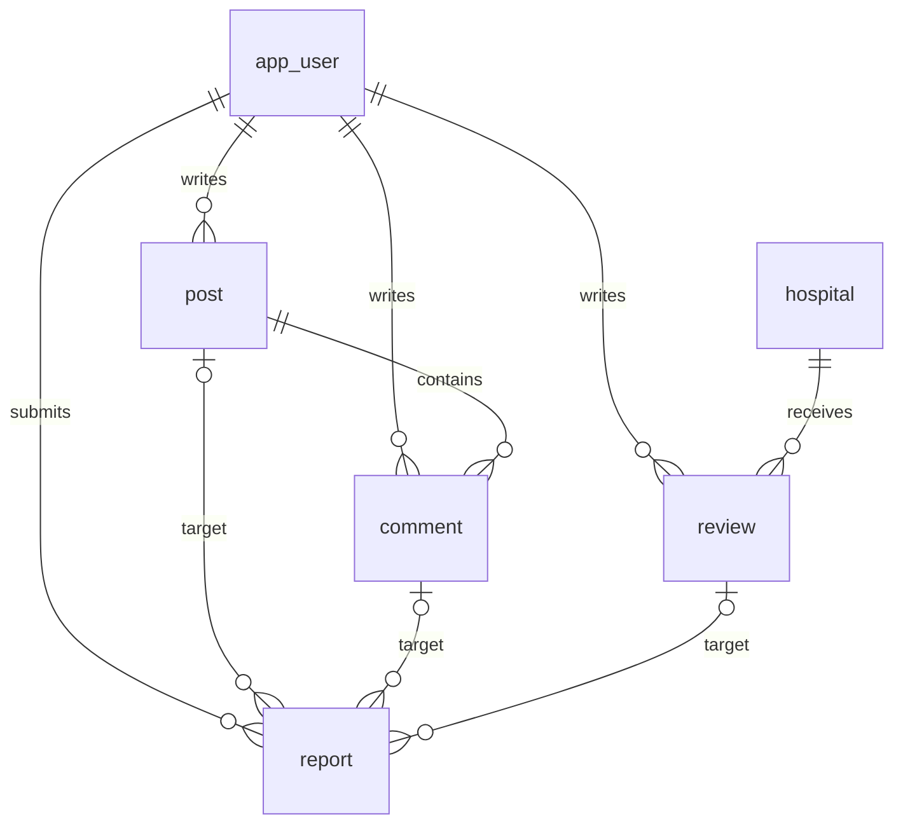

# 데이터베이스 설계 및 검증

`migrations/V001__core.sql`은 초기 스키마입니다. Node 앱에는 DB 연결이 없습니다. 별도 Spring 백엔드에는 PostgreSQL 연결·Flyway·MyBatis를 추가했습니다. Node 테스트의 devDependency인 PGlite는 런타임 DB로 사용하는 것이 아닙니다.

## 관계



신고는 게시글·댓글·리뷰 중 정확히 한 대상을 가집니다. 스키마가 관계·형식·중복을 검증하고 Service 계층이 소유권을 검증해야 합니다. SQL 제약만으로 권한 검증이 완료되지는 않습니다.

| 테이블         | 주요 규칙                                                        |
| -------------- | ---------------------------------------------------------------- |
| app_user       | 대소문자 무시 이메일 유일성, BCrypt 형태의 해시, USER/ADMIN 역할 |
| hospital       | 제공자+외부 식별자 유일성, 좌표 쌍과 범위, 출처 조회 시각        |
| post / comment | 작성자·게시글 외래키, 본문 길이, 공개/숨김/삭제 상태             |
| review         | 회원·병원별 1행, 평점 1~5, 공개/숨김/삭제 상태                   |
| report         | 정확히 한 대상, 회원·대상별 1행, 종결 상태의 처리 시각           |

비밀번호 제약은 해시 문자열 형식만 검사합니다. 실제 BCrypt 생성·검증·비용 설정은 인증 구현에서 수행합니다. 이메일의 완전한 형식 검증과 정규화도 앱 책임입니다. 병원 외부 식별자는 실제 API에서 안정성을 검증한 뒤 저장합니다. 이름·주소만으로 병원을 식별하지 않습니다.

현재 삭제는 상태 변경을 기본으로 하고 외래키는 무분별한 연쇄 삭제를 막습니다. 이 설계는 최종 개인정보 삭제 정책이 아닙니다. 회원 탈퇴 시 익명화/파기, 재가입, 게시글·신고 보존 기간을 운영 전 확정해야 합니다. 삭제된 리뷰의 재작성은 새 행 대신 기존 행을 갱신하는 정책이며, 재신고도 기존 신고 이력을 확인하도록 설계했습니다. 이 동작을 수행하는 API는 아직 없습니다.

`updated_at`은 자동 변경되지 않습니다. 이후 UPDATE SQL에서 명시적으로 갱신합니다. 목록 인덱스는 예상 조회 패턴에 맞춘 초기 설계이며 실제 데이터의 EXPLAIN/부하 테스트로 검증하지 않았습니다. 증상·AI 대화·진단서 내용은 이 스키마에 저장하지 않습니다.

## 현재 재현 가능한 검증

```sh
npm ci
node --test test/database.test.js
```

빈 인메모리 PostgreSQL 엔진에 SQL을 적용하고 이메일/리뷰 중복, 평점 범위, 외래키, 신고 상태, 트랜잭션 롤백을 검증합니다. PGlite 버전은 package-lock.json에 고정됩니다. 테스트 종료 시 DB를 닫으며 외부 DB·실제 회원 데이터는 건드리지 않습니다.

## 별도 PostgreSQL 검증 및 운영 적용

Spring 통합 테스트에서 임시 PostgreSQL 17.11에 V001 적용, Flyway 재실행, JDBC/MyBatis 조회 및 트랜잭션 롤백을 확인했습니다. [백엔드 실행 문서](../backend/README.md)를 참고하세요. 다음 절차는 운영 DB에 대해 아직 수행하지 않았습니다.

1. 서비스와 분리된 새 개발 DB와 최소 권한 사용자를 준비합니다. 접속 정보는 환경변수나 비밀 설정으로 제공합니다.
2. Spring 프로젝트에서 Flyway의 마이그레이션 경로를 이 디렉터리로 연결하거나 원본을 유지하는 리소스 복사 단계를 구성합니다.
3. Flyway로 빈 DB에 적용하고 재시작 시 중복 적용되지 않는지 확인합니다. 기존 스키마에 임의 baseline을 하지 않습니다.
4. JDBC·MyBatis 통합 테스트, 동시 중복 요청, 권한과 트랜잭션 테스트를 실행합니다.
5. 운영 적용 전 백업·복구와 스키마 변경 절차를 검증합니다.

V001은 한 번만 적용하는 forward-only 마이그레이션입니다. 적용된 파일을 수정하지 않고 후속 변경은 V002 이후로 추가합니다. 기존 테이블을 지우는 reset 명령은 제공하지 않습니다. Spring Flyway 실행은 구성했지만 운영 계정 분리·백업·복구 절차는 아직 검증하지 않았습니다.
