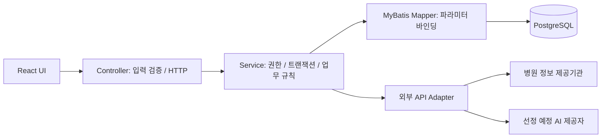

# ADR 001: 프로토타입에서 서비스 구조로 이전

결정일: 2026-11-09. 상태: 목표 구조 결정, 구현 이전은 미완료.

## 결정

원래 요구사항에 맞춰 목표 구조는 React/TypeScript 프론트엔드, Java 21 + Spring Boot/Spring Security 백엔드, MyBatis, PostgreSQL, Flyway로 정합니다. 지금 실행되는 Node.js 프로토타입은 API와 사용자 흐름의 회귀 검증 기준으로 유지합니다. 회원 기능을 Node와 Spring 양쪽에 중복 구현하지 않습니다.

Spring 백엔드 골격과 MyBatis Mapper, Flyway, PostgreSQL 프로세스 통합 검증을 추가했습니다. Java 21, Spring Boot 3.5.16, MyBatis Starter 3.0.5, Maven 3.9.11, 테스트 PostgreSQL 17.11로 고정했습니다. 실행 방법은 [백엔드 문서](../../backend/README.md)에 있습니다. 현재 Spring API는 health만 제공하며 React 이전·회원 인증·운영 DB 연결은 아직 없습니다. React 버전과 빌드는 해당 이전 단계에서 고정합니다.

## 경계

Spring Security는 인증·세션·CSRF를 담당합니다. Service가 로그인 사용자 ID를 사용해 소유권을 확인합니다. 요청 본문의 authorId, role을 권한 판단에 사용하지 않습니다. API는 같은 출처에서 제공하고 운영 CORS는 필요한 출처만 명시합니다.

## 이전 순서와 통과 기준

1. Java 21 빌드와 PostgreSQL 테스트 인스턴스를 준비하고 Flyway로 V001을 실행합니다. 별도 프로세스 DB·JDBC·MyBatis 통합 검증을 추가합니다.
2. 기존 `/api/health`, `/api/guide`, `/api/hospitals` 응답 계약을 유지해 Spring으로 이전합니다. 기존 HTTP·브라우저 테스트로 비교합니다.
3. 회원·인증을 구현합니다. BCrypt 비용은 환경에서 측정하고 72바이트 초과 비밀번호 처리 정책을 명시합니다. 세션 ID 재발급, 로그아웃 무효화, 만료, HttpOnly/Secure/SameSite, CSRF와 다른 사용자 소유 데이터 접근을 테스트합니다.
4. React 화면으로 이전하되 현재 브라우저 테스트의 사용자 흐름을 유지합니다.
5. 이전 완료 후 Node 서버 제거 여부를 별도 커밋에서 결정합니다. 테스트를 삭제해 이전 성공으로 만들지 않습니다.

## API 초안 — 아직 미구현

| 경로                             | 동작                         | 인증 / 검증                                   |
| -------------------------------- | ---------------------------- | --------------------------------------------- |
| POST /api/auth/register          | 가입; 이메일·비밀번호·표시명 | 중복 409, 유효성 400, 비밀번호/해시 응답 금지 |
| POST /api/auth/login             | 세션 생성                    | 실패 401, 오류 메시지 통일, 로그인 요청 제한  |
| POST /api/auth/logout            | 세션 무효화                  | CSRF 적용                                     |
| GET /api/auth/me                 | 현재 회원의 공개 프로필      | 미인증 401                                    |
| GET/POST /api/posts              | 목록 / 작성                  | 쓰기는 회원만; 페이지 크기 최대 50            |
| PATCH/DELETE /api/posts/{id}     | 수정 / 소프트 삭제           | 소유자만, 미인증 401·권한 없음 403            |
| POST /api/posts/{id}/comments    | 댓글 작성                    | 게시글 공개 상태와 회원 확인                  |
| POST /api/hospitals/{id}/reviews | 리뷰 작성                    | 병원 식별자 검증, 회원당 병원별 1건           |
| POST /api/reports                | 신고 생성                    | 로그인 사용자, 정확히 한 대상                 |

목록 정렬은 생성 시각과 ID를 함께 사용합니다. 수정/삭제는 소유자 및 상태 조건을 SQL WHERE에도 포함하고 영향받은 행 수를 확인합니다. JSON 출력은 사용자 비밀번호·세션 식별자를 포함하지 않습니다. 동시 수정의 충돌 정책과 개인정보 삭제 정책은 구현 전에 추가 정의합니다.
